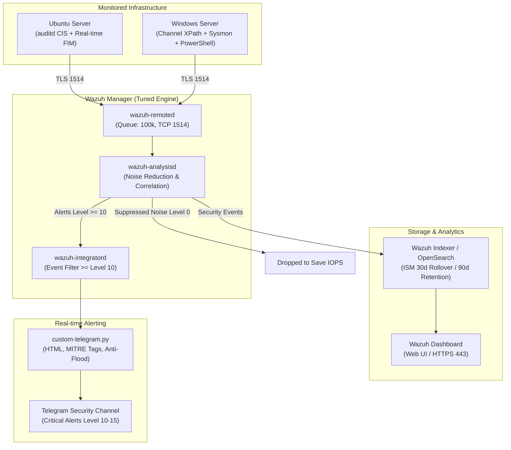

# Wazuh SIEM Production Hardening, Log Optimization & Telegram Alerting

[](https://wazuh.com)
[](https://attack.mitre.org)
[](https://telegram.org)
[](LICENSE.txt)

A complete, production-grade security monitoring solution based on **Wazuh SIEM v4.x**. Optimized for enterprise workloads across **Ubuntu Server** (Linux) and **Windows Server** environments, featuring automated noise suppression, MITRE ATT&CK mapped detection rules, disk protection, and real-time Telegram alerting for critical incidents (Level 10+).

---

## 🏗️ Architecture Overview



---

## ⚡ Key Highlights

*   **Self-Healing One-Click Setup (`setup.sh`):** Fully automated deployment that validates configuration syntax via `wazuh-analysisd -t` with automatic rollback, clears stale crash lock files (`.restart`), and securely stores credentials under `chmod 600`.
*   **High-Throughput Kernel & Queue Tuning:** Expanded `remoted.rqueue_size` (100,000) and `analysisd.rqueue_size` (100,000) with a 131k socket buffer to prevent packet loss during traffic bursts.
*   **Intelligent Log Optimization & Noise Reduction:**
    *   **Windows:** Drops benign Windows Filtering Platform packets (Event IDs 5156/5158) and background `svchost.exe` process churn at the analysis engine level, cutting disk IOPS and storage overhead by up to 75%.
    *   **Linux:** Suppresses high-volume cron session spam (`pam_unix(cron:session)`).
    *   **Manager Storage:** Disables raw archiving (`<logall>no</logall>`), preventing multi-gigabyte disk exhaustion.
*   **Targeted Threat Detection (MITRE ATT&CK Mapped):**
    *   **Defense Evasion:** Detection of audit log clearing (Windows Event 1102 / System 104, Linux `rm -rf /var/log`).
    *   **Credential Access:** Multi-attempt brute force and successful authentication post-bruteforce (SSH, Windows 4625/4624).
    *   **Privilege Escalation:** Additions to Administrators/Domain Admins, modifications to `/etc/sudoers` and `/etc/shadow`.
    *   **Execution:** Malicious/obfuscated PowerShell (Event 4104 with `DownloadString`, `-EncodedCommand`, `Bypass`) and LOLBin proxy execution (`certutil`, `bitsadmin`, `vssadmin`).
*   **Real-time Telegram Alerting (Level $\ge$ 10):**
    *   Pure Python standard library implementation (zero third-party dependencies required on the manager).
    *   Enterprise TLS & proxy-resilient: automatically handles corporate SSL inspection and isolated Python CA stores without certificate verification crashes.
    *   Rich HTML formatting with severity badges (🔥 CRITICAL, 🚨 HIGH, ⚠️ WARNING), target user/process, source IP, and MITRE tactics/techniques.
    *   Built-in 15-second sliding-window deduplication and anti-flood protection against Telegram API rate limits (HTTP 429).
*   **OpenSearch Index Lifecycle Management (ISM):**
    *   Automated index rotation (30 days or 30 GB per shard) and retention purge (90 days) to prevent disk saturation.

---

## 📂 Repository Layout

```text
.
├── setup.sh                         # Master turnkey installer & self-healing configuration script
├── .env.example                     # Environment template for credentials
├── .gitignore                       # Safeguard preventing .env, keys, and logs from Git commits
├── README.md                        # Documentation and architecture guide
├── server-config/                   # Reference server configurations
│   ├── ossec.conf                   # Hardened Wazuh Manager configuration
│   ├── local_internal_options.conf  # High-throughput internal queue settings
│   └── indexer_ism_policy.json      # OpenSearch ISM retention & rollover policy
├── rules-and-decoders/              # Custom detection & drop rules (IDs 100000–120000)
│   ├── local_rules.xml              # Baseline Linux & Windows security rules
│   ├── local_decoder.xml            # Custom auxiliary log decoders
│   └── ad_ds_rules.xml.optional     # Optional Active Directory Domain Services rules (DCSync, Kerberoasting)
├── integrations/telegram/           # Production Telegram Alerting Module
│   ├── custom-telegram.py           # Alert parser with HTML formatting & flood control
│   ├── custom-telegram              # Executable wrapper for wazuh-integratord
│   └── ossec_integration.xml        # XML integration snippet
├── agent-configs/                   # Host-level deployment scripts & configurations
│   ├── linux/
│   │   ├── ossec.conf               # Ubuntu agent configuration (Real-time FIM)
│   │   ├── audit.rules              # CIS Benchmark auditd rules
│   │   └── install-ubuntu.sh        # Automated Ubuntu installer
│   └── windows/
│       ├── ossec.conf               # Windows agent configuration (XPath channel queries)
│       ├── sysmonconfig.xml         # High-signal Sysmon profile
│       └── install-windows.ps1      # Automated PowerShell installer
└── docs/                            # In-depth operation runbooks
    ├── DEPLOYMENT_GUIDE.md          # Step-by-step deployment manual
    ├── LOG_OPTIMIZATION.md          # Log normalization & noise reduction architecture
    └── TESTING_AND_VERIFICATION.md  # Verification runbooks & rule test cases
```

---

## 🚀 Quick Start Guide

### 1. Server Configuration (Wazuh Manager)

Execute the master setup script directly from the repository root:

```bash
cd wazuh-siem
sudo bash setup.sh
```

**What the script does automatically:**
1. Securely prompts for your Telegram Bot Token and Chat ID (if not already set in `.env`).
2. Enforces strict `root:root (600)` file permissions on `.env`.
3. Creates timestamped backups of active server configurations.
4. Cleans up any stale crash lock files (`.restart`) to prevent API stalls.
5. Injects the Telegram integration into the main `<ossec_config>` section and optimizes daemon queues using safe Python XML manipulation.
6. Deploys custom detection rules and verifies rule compilation using `wazuh-analysisd -t` with auto-rollback on syntax failure.
7. Gracefully restarts `wazuh-manager` and `wazuh-dashboard`.
8. Dispatches an end-to-end verification alert directly to your Telegram chat.

---

### 2. Monitored Agent Deployment

#### Ubuntu Server (Linux)
Run on the target Ubuntu node (20.04 / 22.04 / 24.04 LTS):
```bash
sudo bash agent-configs/linux/install-ubuntu.sh wazuh.garuda.net
```
*Installs the agent, deploys CIS benchmark `auditd` rules, activates real-time FIM for `/etc`, `/boot`, `/bin`, `/sbin`, and configures automatic noise suppression.*

#### Windows Server (2016 / 2019 / 2022 / 2025)
Run in an elevated PowerShell session:
```powershell
Set-ExecutionPolicy Bypass -Scope Process -Force
.\agent-configs\windows\install-windows.ps1 -WazuhManager "wazuh.garuda.net"
```
*Installs the official MSI agent, configures targeted XPath queries on `Security`, `System`, and `PowerShell` channels, and starts the service.*

---

## 🧪 Verification & Rule Testing

To validate custom detection rules manually using the native rule compiler:
```bash
/var/ossec/bin/wazuh-analysisd -t
```

To test an event against the rule engine:
```bash
/var/ossec/bin/wazuh-logtest
```

**Example Test Payload (Windows Audit Log Cleared - Event 1102):**
```json
{"win":{"system":{"providerName":"Microsoft-Windows-Security-Auditing","eventID":"1102","computer":"SRV-01.corp"},"eventdata":{"subjectUserName":"Administrator"}}}
```
*Expected Output: Triggers Rule `100010` (Level 14 - Critical) $\rightarrow$ Instantly dispatched to Telegram.*

---

## 🔒 Security Baseline

*   **Least Privilege:** All sensitive credentials (`.env`) are restricted strictly to `root:root` with mode `600`.
*   **Data Protection:** Sensitive passwords, API keys, and certificates are excluded from Git commits via `.gitignore`.
*   **FIM Privacy:** The File Integrity Monitoring module applies `<nodiff>` to sensitive credential stores (`/etc/shadow`, `/etc/gshadow`) to prevent password hashes from being logged in diff outputs.

---

## 📄 License

This project is licensed under the Apache License 2.0 - see the [LICENSE.txt](LICENSE.txt) file for details.
